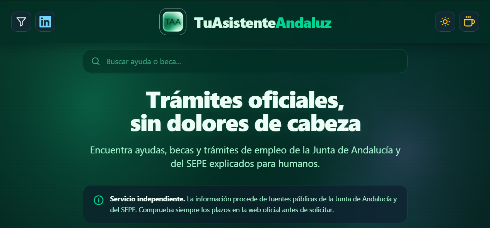

# TuAsistenteAndaluz

<p align="center">
  
</p>

Plataforma web que centraliza, explica y resume ayudas, becas y trámites de la Junta de Andalucía, el SEPE y la Seguridad Social. Su objetivo es simplificar la burocracia administrativa para el ciudadano mediante la automatización con Inteligencia Artificial.

Este repositorio contiene el código fuente del sistema de ingesta, procesamiento y publicación automatizada de datos.

## Características Principales

- **Ingesta automatizada**: Rastreo diario de las webs oficiales (BOJA, SEPE, Junta de Andalucía) mediante Playwright, resolviendo bloqueos de cookies de forma automática.
- **Procesamiento con IA**: Análisis de los textos oficiales con Anthropic Claude para extraer requisitos, plazos, documentación y pasos de solicitud.
- **Filtro anti-alucinaciones**: Validación estricta del JSON devuelto por la IA. Si la información es genérica o incompleta, el trámite se descarta automáticamente para evitar contenido de baja calidad.
- **Flujo de aprobación manual**: Los trámites nuevos se guardan en cuarentena en la base de datos. El administrador recibe una alerta por Telegram y decide si se publica en la web con un solo clic.
- **Generación de SEO estático**: Creación de páginas HTML estáticas por cada trámite, optimizadas con títulos cortos, meta descripciones, Open Graph y JSON-LD (Schema.org) para mejorar el posicionamiento en Google.

## Stack Tecnológico

- **Frontend**: HTML5, CSS3 (Tailwind CSS), JavaScript Vanilla. Desplegado en Vercel.
- **Backend**: Node.js (ES Modules). Desplegado en un VPS con PM2.
- **Base de Datos**: Supabase (PostgreSQL).
- **Motor de IA**: Anthropic Claude (SDK oficial).
- **Rastreo Web**: Playwright con Stealth.
- **Integración de Avisos**: Bot de Telegram.
- **Generador SEO**: Script en Node.js que compila las páginas estáticas y el sitemap.

## Arquitectura del Flujo de Trabajo

El sistema está diseñado para funcionar de forma autónoma, requiriendo únicamente la intervención humana para la aprobación final de la publicación.

1. **Rastreo**: El crawler visita las fuentes oficiales, acepta los avisos de cookies y extrae el texto plano.
2. **Análisis**: Claude procesa el texto y genera una estructura JSON con los datos del trámite.
3. **Validación**: Un script verifica que la guía contenga información real y no textos de relleno.
4. **Cuarentena**: Si es válida, se guarda en Supabase con la etiqueta de no publicada.
5. **Notificación**: El bot de Telegram envía un mensaje con el resumen del trámite al administrador.
6. **Aprobación**: El administrador pulsa "Publicar" desde el móvil.
7. **Despliegue**: El bot actualiza la base de datos, genera el HTML estático, hace un `git push` y Vercel despliega los cambios automáticamente.

## Estructura del Proyecto

```text
/
├── engine/                  # Backend y scripts de automatización
│   ├── src/
│   │   ├── bot.js           # Bot de Telegram (publicación y alertas)
│   │   ├── crawler.js       # Rastreador principal con Playwright
│   │   ├── updater.js       # Comprobador de cambios en webs oficiales
│   │   ├── config.js        # URLs de origen y palabras clave
│   │   └── lib/
│   │       ├── ai.js        # Integración con Anthropic Claude
│   │       ├── db.js        # Cliente de Supabase y normalización
│   │       ├── html.js      # Conversor de JSON a HTML seguro
│   │       └── browser.js   # Configuración de Playwright y cookies
│   └── .env                 # Variables de entorno (no incluido en el repo)
├── scripts/
│   └── generar-paginas.mjs  # Generador de páginas estáticas y SEO
└── public/                  # Frontend estático
    ├── index.html           # Página principal
    ├── app.js               # Lógica del frontend
    ├── styles.css           # Estilos base
    └── ayuda/               # Carpeta generada con las fichas 
```
## Automatización en Servidor
El sistema utiliza crontab en el servidor VPS para ejecutarse de forma autónoma:

Crawler (08:00): Busca nuevas ayudas y envía alertas.

Updater (12:00): Revisa si las webs oficiales han cambiado y actualiza las guías existentes. Utiliza el flag --no-retirar para garantizar que ninguna ficha se oculte automáticamente sin supervisión humana.

## Decisiones de Diseño y Calidad
Tolerancia a fallos: Si la IA devuelve un JSON mal formado o la fuente oficial bloquea la petición, el sistema registra el error y continúa con el siguiente trámite sin detener el flujo.

Coste operativo: El mantenimiento y la actualización de las 40 fichas actuales supone un coste estimado de céntimos al día en tokens de IA, gracias a la comprobación previa mediante hashes de contenido.

SEO técnico: Todas las guías generadas superan la validación de Schema.org con 0 errores y 0 advertencias.

## Licencia
Este proyecto es de uso privado y educativo. No está afiliado a la Junta de Andalucía, el SEPE ni la Seguridad Social. Los datos mostrados son de carácter orientativo.